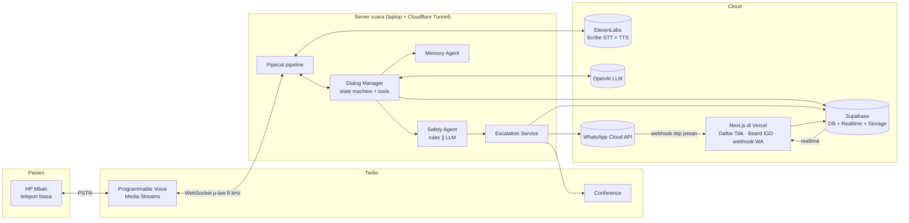
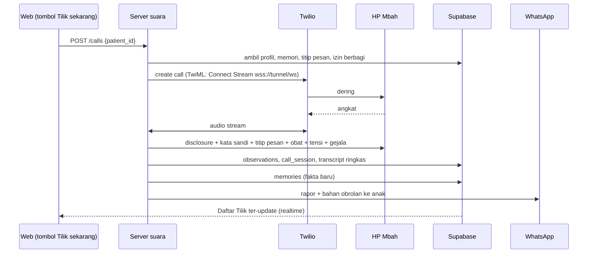
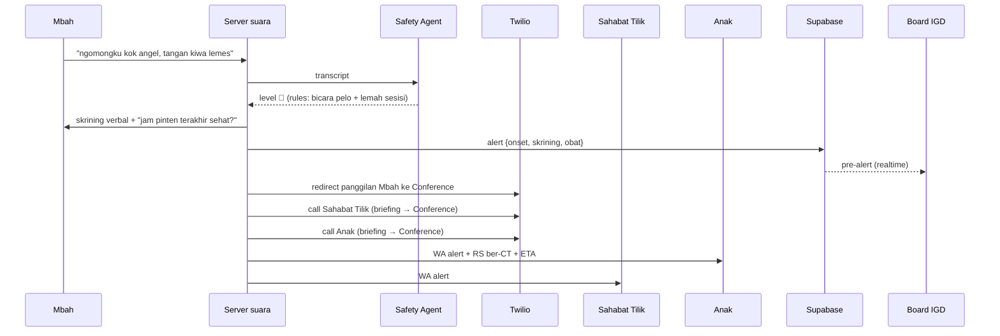

# 03 · Arsitektur Teknis

Status: **rancangan Stage 0.** Bagian bertanda 🧪 harus divalidasi lewat spike di [09_STAGE0_CHECKLIST.md](09_STAGE0_CHECKLIST.md) sebelum dikunci.

---

## 1. Tech stack

| Lapisan | Pilihan | Alasan | Diputuskan oleh |
|---|---|---|---|
| Orkestrasi suara | **Pipecat** (Python, open-source) | Pipeline real-time sendiri, jadi kode inti adalah karya tim. Sudah mendukung Twilio, ElevenLabs, dan OpenAI | Tim |
| STT | **ElevenLabs Scribe** (realtime, WebSocket) | Satu vendor dengan TTS. Mendukung input μ-law 8 kHz (audio telepon). Pipecat punya `ElevenLabsRealtimeSTTService` | Tim |
| TTS | **ElevenLabs** (model dipilih lewat spike 🧪) | `eleven_v3` resmi mendukung bahasa Jawa, tapi latensi untuk percakapan real-time harus diuji. Model latensi rendah (Flash/Turbo) harus dicek dukungan bahasa Indonesia/Jawa-nya | Tim (vendor) · model: spike |
| LLM | **OpenAI** (model dipilih lewat spike 🧪) | Kriteria: keandalan tool calling, TTFT, pemahaman Indonesia/Jawa, biaya. Pilih yang **termurah** yang lolos | Tim (vendor) · model: spike |
| VAD | Silero VAD (bawaan Pipecat, lokal, gratis) | Tanpa biaya API | Rekomendasi |
| Telepon | **Twilio Programmable Voice** (Media Streams + Conference), akun **trial** | Akun sudah ada | Tim |
| Fallback panggilan | Pipecat **SmallWebRTC** (panggilan lewat browser) | Gratis. Dipakai kalau trial Twilio tidak bisa ke +62 🧪 | Rekomendasi |
| WhatsApp | **WhatsApp Cloud API (Meta)** | Resmi (tidak berisiko diblokir seperti gateway tidak resmi), ada nomor tes gratis, webhook untuk "titip pesan". Pesan dalam jendela 24 jam setelah pengguna mengirim pesan tidak memerlukan template | Rekomendasi (didelegasikan tim) |
| Database | **Supabase** (free tier: Postgres + Realtime + Storage) | Realtime untuk Board IGD tanpa server tambahan. Storage untuk pesan suara anak | Rekomendasi |
| Web | **Next.js + Tailwind + shadcn/ui** di **Vercel Hobby** (gratis) | UI rapi (aspek Fungsionalitas & Desain), API route gratis untuk webhook WA | Rekomendasi |
| Hosting server suara | **Laptop tim + Cloudflare Quick Tunnel** (gratis) | Paling hemat dan latensi dekat. URL tunnel dikirim saat membuat panggilan, jadi tidak perlu domain tetap | Rekomendasi |
| Analisis suara | `praat-parselmouth`, `librosa` (offline) | Gratis, lokal | Rekomendasi |
| Evaluasi | Harness Python (mode teks) + OpenAI sebagai "pasien sintetis" | **Tidak memakai kredit ElevenLabs** | Rekomendasi |

> Keputusan bertanda "Rekomendasi" dipilih karena tim mendelegasikannya, dengan prinsip **paling hemat**. Semuanya boleh diubah. Catat perubahan di [12_KEPUTUSAN_DAN_PERTANYAAN.md](12_KEPUTUSAN_DAN_PERTANYAAN.md).

---

## 2. Gambaran komponen



### 2.1 Pipeline suara (satu panggilan)
```
Twilio audio (μ-law 8k) → TwilioFrameSerializer → Silero VAD
  → ElevenLabs Scribe realtime (STT, bahasa: id 🧪)
  → Context aggregator → Dialog Manager (state + prompt) → OpenAI (streaming, tools)
  → ElevenLabs TTS (output μ-law 8k 🧪) → Twilio
  ∥ transcript bus → Safety Agent (rules sinkron + LLM klasifikasi asinkron)
  ∥ transcript bus → Memory Agent (ekstraksi fakta setelah panggilan)
```

### 2.2 Dialog Manager
- **State machine** eksplisit: `GREETING → FAMILY_MESSAGE → MEDICATION → BLOOD_PRESSURE → SYMPTOMS → CLOSING`, plus state darurat `STROKE_SCREEN → ESCALATING`. Detail ada di [05](05_DESAIN_PERCAKAPAN.md).
- LLM **hanya** mengisi bahasa natural di dalam tiap state dan memanggil **tool** yang tervalidasi skema:
  - `log_adherence(status, reason?)`
  - `log_blood_pressure(systolic, diastolic, confirmed: bool)`
  - `log_symptom(code, verbatim)`
  - `record_last_known_well(time_text, parsed_time?)`
  - `advance_state(next_state)`
  - `trigger_escalation(level, reasons[])`
- Validasi tool call (tipe, rentang angka masuk akal) dilakukan di kode, bukan dipercayakan ke LLM.

### 2.3 Safety Agent (2 jalur di MVP)
- **Jalur aturan (sinkron, setiap giliran):** kata kunci/pola gejala, ambang tensi. Cepat dan deterministik.
- **Jalur LLM (asinkron):** klasifikasi ringkasan percakapan → `{level, reasons}`.
- **OR-gate:** level akhir = level tertinggi dari kedua jalur. Dioptimalkan untuk recall.
- Jalur 3 (anomali suara) = SHOULD/LATER.

### 2.4 Escalation Service (🔴), rancangan 🧪
Panggilan pasien berjalan sebagai *bidirectional Media Stream*. Untuk menyambungkan orang lain:
1. TILIK memberi tahu pasien ("Bu, kula sambungaken kalih Bu Tini lan Mas Dika").
2. Panggilan pasien **dialihkan** (Twilio REST update) ke TwiML `<Dial><Conference>`. Pada saat ini TILIK keluar dari percakapan suara.
3. Panggilan keluar ke Sahabat Tilik dan anak: **briefing pendek** (audio TTS ElevenLabs yang di-generate per insiden, diputar dengan `<Play>`), lalu `<Dial><Conference>` ke ruang yang sama.
4. Paralel: WA alert (ringkasan + jam onset + RS ber-CT + ETA statis) dan insert `alerts` ke Supabase → Board IGD (realtime).

> Pada Twilio trial, **semua peserta harus nomor terverifikasi** (maksimal 5 nomor). Lihat [10](10_ANGGARAN_KUOTA.md).
> Pada mode fallback browser, konferensi PSTN tidak tersedia. Eskalasi dilakukan lewat WA alert + Board IGD, dan panggilan ke anak/tetangga **hanya kalau** Twilio bisa menelepon nomor Indonesia.

### 2.5 Rute ke RS ber-CT
- **MVP (hemat):** tabel statis jarak/waktu tempuh dari desa-desa demo ke RS jejaring (dihitung sekali secara manual dari peta). Tanpa API berbayar.
- Daftar RS: RSUD Wonosari, RS Saptosari, RS Panti Rahayu (Gunungkidul), RS Akademik UGM, RSUP Dr. Sardjito (Sleman). **Ketersediaan CT 24 jam wajib diverifikasi** (pertanyaan terbuka).

---

## 3. Alur data utama

### 3.1 Panggilan harian (🟢)


### 3.2 Darurat (🔴)


---

## 4. Anggaran latensi (target, wajib diukur)

| Tahap | Target MVP | Catatan |
|---|---|---|
| Jaringan Twilio ↔ server | ? 🧪 | Bergantung region/edge Twilio. Diukur di spike |
| Deteksi akhir giliran (VAD) | ±500–800 ms | Lansia butuh jeda lebih panjang. Tuning di Stage 2 |
| STT final (Scribe realtime) | ? 🧪 | Klaim vendor < 150 ms, harus diukur sendiri |
| LLM time-to-first-token | ? 🧪 | Penentu utama pemilihan model OpenAI |
| TTS time-to-first-byte | ? 🧪 | Bandingkan model ElevenLabs |
| **Total p50 (akhir ucapan → suara TILIK)** | **≤ 1,5 s** | Final: ≤ 1,0 s |

---

## 5. Lingkungan & konfigurasi

Daftar variabel lingkungan ada di [`.env.example`](../../.env.example). Prinsip:
- Secrets **tidak pernah** di-commit.
- `DEMO_MODE=true` mengunci semua tujuan panggilan/WA ke **daftar nomor terverifikasi tim** (allowlist) dan menonaktifkan nomor darurat sungguhan.

## 6. Struktur repo yang direncanakan
Lihat [13_KONVENSI_REPO.md](13_KONVENSI_REPO.md).

## 7. Hal yang sengaja **tidak** dipakai di MVP
| Tidak dipakai | Alasan |
|---|---|
| ElevenLabs Agents Platform | Inti percakapan harus kode tim (keputusan tim) |
| Embedding/vector search untuk memori | Hemat. Daftar fakta JSON sudah cukup untuk MVP |
| Google Maps Directions API | Berbayar. Pakai tabel statis |
| Server cloud berbayar | Hemat. Pakai laptop + tunnel |
| Voice cloning | Etika (lihat [06](06_ETIKA_PRIVASI_REGULASI.md)) |
