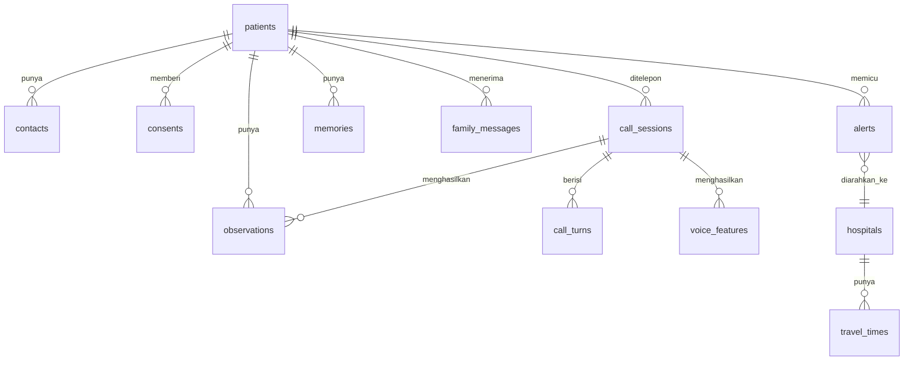

# 04 · Data Model

Database: **Supabase (Postgres)**. Semua data di MVP **fiktif** (persona demo). Skema ini rancangan Stage 0 dan akan diwujudkan sebagai migration di Stage 1.

---

## 1. Diagram relasi

## 2. Tabel

### `patients`
| Kolom | Tipe | Catatan |
|---|---|---|
| id | uuid PK | |
| display_name | text | "Bu Sri" |
| full_name | text | Fiktif |
| birth_year | int | |
| sex | text | `F`/`M` |
| village | text | Desa (untuk tabel waktu tempuh) |
| phone_e164 | text | Wajib ada di allowlist saat `DEMO_MODE` |
| preferred_language | text | `id` / `jv-krama` / `jv-ngoko` |
| call_time_local | time | Jam panggilan harian (dipilih pasien) |
| family_codeword | text | Kata sandi keluarga. **Sensitif**: jangan tampil di web |
| conditions | text[] | `hypertension`, `diabetes`, … |
| medications | jsonb | `[{name, schedule, is_anticoagulant}]` |
| has_bp_monitor | bool | |
| active | bool | |
| created_at | timestamptz | |

### `contacts`
| Kolom | Tipe | Catatan |
|---|---|---|
| id | uuid PK | |
| patient_id | uuid FK | |
| role | text | `child` / `sahabat_tilik` / `kader` / `nakes` |
| name | text | |
| phone_e164 | text | |
| whatsapp_e164 | text | |
| escalation_order | int | 1 = dihubungi pertama (biasanya Sahabat Tilik) |
| receives_daily_report | bool | |

### `consents`
| Kolom | Tipe | Catatan |
|---|---|---|
| id | uuid PK | |
| patient_id | uuid FK | |
| consent_type | text | `service` / `share_with_family` / `voice_analysis` / `store_transcript` |
| scope | jsonb | Misal `{"medication": true, "bp": true, "stories": true}` (berbagi bertingkat) |
| given_by | text | `patient` / `proxy` |
| granted_at / revoked_at | timestamptz | |

### `call_sessions`
| Kolom | Tipe | Catatan |
|---|---|---|
| id | uuid PK | |
| patient_id | uuid FK | |
| direction | text | `outbound` / `inbound` |
| transport | text | `twilio` / `webrtc` |
| twilio_call_sid | text | Nullable |
| status | text | `queued` / `ringing` / `in_progress` / `completed` / `no_answer` / `failed` |
| final_level | text | `green` / `yellow` / `red` |
| started_at / ended_at | timestamptz | |
| latency_p50_ms / latency_p95_ms | int | Diisi dari log pipeline |
| summary | text | Ringkasan untuk nakes |
| family_talking_points | text[] | "Bahan obrolan" |

### `call_turns` (transkrip minimal)
| Kolom | Tipe | Catatan |
|---|---|---|
| id | bigserial PK | |
| session_id | uuid FK | |
| speaker | text | `tilik` / `patient` |
| state | text | State dialog saat giliran ini |
| text | text | Transkrip. **Retensi singkat** (lihat §4) |
| ts | timestamptz | |

### `observations`
| Kolom | Tipe | Catatan |
|---|---|---|
| id | uuid PK | |
| patient_id, session_id | uuid FK | |
| kind | text | `adherence` / `blood_pressure` / `symptom` / `last_known_well` / `stroke_screen` |
| value | jsonb | Misal `{"systolic":150,"diastolic":90,"confirmed":true}` |
| verbatim | text | Kutipan ucapan pasien (bukti) |
| source | text | `rule` / `llm` / `patient_report` |
| observed_at | timestamptz | |

### `alerts`
| Kolom | Tipe | Catatan |
|---|---|---|
| id | uuid PK | |
| patient_id, session_id | uuid FK | |
| level | text | `yellow` / `red` |
| reasons | jsonb | `[{"path":"rule","code":"SPEECH_SLURRED","quote":"..."}]` |
| last_known_well | timestamptz | Nullable |
| golden_period_deadline | timestamptz | `last_known_well + 4,5 jam` |
| target_hospital_id | uuid FK | |
| eta_minutes | int | Dari `travel_times` |
| status | text | `open` / `acknowledged` / `closed` |
| acknowledged_by | text | |
| created_at | timestamptz | |

### `memories`
| Kolom | Tipe | Catatan |
|---|---|---|
| id | uuid PK | |
| patient_id | uuid FK | |
| fact | text | "Cucu (Rani) wisuda bulan depan" |
| category | text | `family` / `hobby` / `health_context` / `preference` |
| source_session_id | uuid FK | |
| last_used_at | timestamptz | |
| expires_at | timestamptz | Opsional |

### `family_messages` (titip pesan)
| Kolom | Tipe | Catatan |
|---|---|---|
| id | uuid PK | |
| patient_id | uuid FK | |
| from_contact_id | uuid FK | |
| kind | text | `text` / `audio` |
| text | text | |
| audio_path | text | Path di Supabase Storage (suara asli anak) |
| status | text | `pending` / `delivered` |
| delivered_session_id | uuid FK | |

### `voice_features` (SHOULD)
| Kolom | Tipe | Catatan |
|---|---|---|
| id | bigserial PK | |
| session_id | uuid FK | |
| utterance_idx | int | |
| articulation_rate | float | Suku kata/detik |
| pause_ratio | float | |
| hnr_db, f0_range_hz, jitter, shimmer | float | |
| **(tidak ada audio)** | | Audio mentah tidak disimpan |

### `hospitals` & `travel_times`
| Tabel | Kolom |
|---|---|
| `hospitals` | id, name, regency, has_ct_24h (**wajib diverifikasi**), code_stroke_network (bool), phone_display (**tidak dipanggil di demo**), lat, lng |
| `travel_times` | village, hospital_id, minutes (statis, dihitung manual), source_note |

## 3. Pemetaan ke FHIR R4 (label "SATUSEHAT-ready", ekspor JSON di Stage 2)

| Data TILIK | Resource FHIR | Catatan |
|---|---|---|
| patients | `Patient` | |
| observations (tensi) | `Observation` | LOINC panel tekanan darah, kode komponen sistolik/diastolik. **Kode diverifikasi saat implementasi** |
| observations (adherence, gejala) | `Observation` | Kode lokal |
| alerts | `Flag` / `Communication` | Pre-alert ke IGD |
| contacts | `RelatedPerson` | |

## 4. Retensi & privasi data

| Data | Retensi MVP (data fiktif) | Rencana produksi |
|---|---|---|
| Audio mentah | **Tidak disimpan** (kecuali rekaman uji yang disengaja untuk analisis suara offline, dengan izin, disimpan lokal) | Tidak disimpan |
| `call_turns.text` | Disimpan untuk audit demo | Dihapus otomatis setelah N hari (N ditentukan bersama mitra) |
| Observations, alerts | Disimpan | Mengikuti kebijakan rekam medis faskes mitra |
| `family_codeword` | Disimpan, tidak pernah tampil di UI | Dienkripsi |

Kebijakan lengkap ada di [06_ETIKA_PRIVASI_REGULASI.md](06_ETIKA_PRIVASI_REGULASI.md).

## 5. Data seed (Stage 1)
- 1 pasien utama (Bu Sri) + 4–6 pasien pengisi untuk Daftar Tilik (variasi 🟢/🟡/🔴/no-answer).
- Kontak: Mas Dika (anak), Bu Tini (Sahabat Tilik). **Nomor = nomor HP anggota tim yang terverifikasi di Twilio.**
- 5 RS + tabel waktu tempuh untuk 2–3 desa demo di Gunungkidul.
