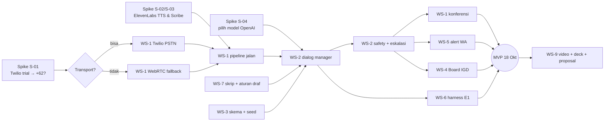

# 08 · Roadmap & Job Breakdown

Pembagian kerja **per job/workstream, tidak per orang** (keputusan tim). Tim bebas mengambil job mana pun. Yang penting setiap job punya *definition of done* dan urutan ketergantungannya jelas.

---

## 1. Tahapan

| Stage | Periode | Tujuan | Gate keluar |
|---|---|---|---|
| **Stage 0: Persiapan** | 15 Okt | Semua akun, kunci, keputusan, konten, dan spike siap sebelum menulis kode produk | **G0** |
| **Stage 1: MVP** | 16–18 Okt | MVP end-to-end + deliverable lomba | **G1, G2, G3** |
| **Stage 2: Menuju final** | 19 Okt – 31 Okt | Fitur SHOULD/LATER prioritas, uji manusia, polish demo, latihan pitch | **G4** (gladi 31 Okt) |
| **Stage 3: Pasca-lomba** | Setelah 1 Nov | Pilot dengan mitra, regulatory sandbox | – |

> **Deadline efektif = 18 Okt** (keputusan tim). Jam/tanggal resmi tutup submission panitia **belum diketahui** (Q-01). Kalau ternyata lebih awal, roadmap Stage 1 harus dipadatkan. Prioritasnya sudah diurutkan untuk itu (lihat §4).

## 2. Workstream (job)

| Kode | Workstream | Isi |
|---|---|---|
| **WS-1** | Telepon & pipeline suara | Pipecat, Twilio Media Streams, Scribe STT, TTS, VAD, barge-in, fallback WebRTC, konferensi |
| **WS-2** | Dialog & keselamatan | State machine, prompt, tool calling, Safety Agent (rules + LLM), memori |
| **WS-3** | Data & backend | Skema Supabase, seed, API internal (mulai panggilan, simpan observasi) |
| **WS-4** | Web | Daftar Tilik Hari Ini, Board IGD, konsol demo (tombol "Tilik sekarang"), UI telepon fallback |
| **WS-5** | WhatsApp | Rapor + bahan obrolan, alert 🔴, webhook titip pesan (teks & suara) |
| **WS-6** | Evaluasi | Harness E1, persona, laporan angka, E2 terbatas |
| **WS-7** | Konten klinis & bahasa | Skrip ID/JV, aturan tanda bahaya, edukasi, briefing, data RS & waktu tempuh |
| **WS-8** | Analisis suara (SHOULD) | Ekstraksi fitur offline + grafik |
| **WS-9** | Deliverable | README, video ≤ 2 menit, proposal ≤ 10 hlm, pitch deck |
| **WS-10** | Ops & anggaran | Akun, kunci, verifikasi nomor, tunnel, pemantauan kredit |

## 3. Ketergantungan (jalur kritis)

## 4. Stage 1: rencana harian (MVP)

Urutan prioritas, kalau waktu terpotong: **P-A** (wajib untuk demo inti) → **P-B** → **P-C**.

### Kamis, 16 Okt: "Satu panggilan utuh"
| Job | Target hari ini | Prioritas |
|---|---|---|
| WS-1 | Panggilan keluar tersambung (PSTN atau WebRTC), TILIK bisa bicara & mendengar, barge-in | P-A |
| WS-2 | State machine GREETING → CLOSING dengan tool calling (obat, tensi, gejala) | P-A |
| WS-3 | Skema + seed (Bu Sri, kontak, RS, waktu tempuh) | P-A |
| WS-4 | Kerangka web + Daftar Tilik (baca dari DB) | P-B |
| WS-5 | Kirim pesan WA dari nomor tes ke nomor tim | P-B |
| WS-7 | Skrip final MVP (ID + frasa JV), daftar aturan draf | P-A |
| WS-9 | Kerangka proposal & deck (struktur slide) | P-C |

**Gate G1 (malam 16 Okt):** satu panggilan harian lengkap 🟢 berjalan end-to-end dan observasi tersimpan di DB.

### Jumat, 17 Okt: "Darurat & keluarga"
| Job | Target | Prioritas |
|---|---|---|
| WS-2 | Safety Agent (rules + LLM, OR-gate), STROKE_SCREEN, last known well, memori sederhana | P-A |
| WS-1 | Konferensi (alihkan panggilan + panggil Sahabat Tilik & anak + briefing) | P-A |
| WS-4 | Board IGD realtime + tampilan alert | P-A |
| WS-5 | Alert 🔴 (RS ber-CT + ETA) + rapor + bahan obrolan + titip pesan (webhook) | P-A / P-B |
| WS-6 | Harness E1 jalan untuk ≥ 10 persona | P-B |
| WS-9 | Draf proposal + deck berisi konten | P-B |

**Gate G2 (malam 17 Okt):** skenario demo babak 2 (🔴) berjalan end-to-end: HP tim berdering, WA terkirim, Board IGD menyala.

### Sabtu, 18 Okt: "Bekukan & kirim"
| Job | Target | Prioritas |
|---|---|---|
| WS-6 | Harness 30 skenario → tabel angka | P-A |
| WS-1/2 | Perbaikan bug dari harness. **Freeze fitur siang hari** | P-A |
| WS-9 | Rekam video (babak 1 & 2) + edit ≤ 2 menit | P-A |
| WS-9 | README (alur + cara menjalankan), proposal final, deck final (+ slide penggunaan AI & etika) | P-A |
| WS-8 | Grafik analisis suara offline (kalau ada waktu) | P-C |
| WS-10 | Cek sisa kredit, catat untuk Stage 2 | P-B |

**Gate G3 (18 Okt):** semua deliverable terkirim sesuai mekanisme panitia (Q-01).

## 5. Stage 2: menuju Grand Final (19 Okt – 31 Okt)

| Periode | Fokus |
|---|---|
| 19–23 Okt (sebelum pengumuman) | Rapikan utang teknis MVP. Siapkan uji manusia (lembar persetujuan, skrip wawancara). Cari nakes reviewer. Fitur SHOULD: telepon balik, Nudge Kangen, analisis suara offline |
| 23 Okt | Pengumuman finalis |
| 24–30 Okt (jika lolos) | **Endpoint sinyal eksternal + simulasi jam tangan (F-18)**, protokol tidak diangkat (F-19), panel tanda vital suara **live**, endpointing/turn-taking untuk lansia, deteksi krama/ngoko, UI berbagi bertingkat, eval ≥ 100 skenario, uji 5–10 lansia + kutipan nakes, latihan pitch ≥ 3×, siapkan properti (HP jadul) |
| 31 Okt | **G4: gladi bersih** di jaringan seluler, video cadangan per babak, cek kredit ElevenLabs cukup untuk demo |
| 1 Nov | Grand Final |

> Fitur Stage 2 dipilih berdasarkan **sisa kredit ElevenLabs** dan masukan juri dari tahap penyisihan (kalau ada).

## 6. Stage 3: roadmap produk (untuk slide)
1. Pilot bersama jejaring Code Stroke (RSA UGM, Gunungkidul) melalui regulatory sandbox KMK 951/2026.
2. Integrasi SATUSEHAT (FHIR) & PSC 119.
3. Mode sovereign (model terbuka seperti Sahabat-AI + STT self-hosted).
4. Jam kronis (tren suara mingguan: sinyal gagal jantung/kognitif), skrining kamera via HP keluarga.
5. **Integrasi perangkat (agnostik perangkat):** tombol SOS GSM dengan deteksi jatuh (paket murah untuk lansia tanpa smartphone), jam tangan (deteksi jatuh, notifikasi ritme tidak teratur, tensi) lewat platform kesehatan ponsel keluarga, tensimeter Bluetooth di Posyandu/kader. Lihat [15_DEFENSE_BANK.md](15_DEFENSE_BANK.md) §1.
5. Bahasa daerah lain (Sunda, Madura, …).

## 7. Definition of Done umum (setiap job)
- Ada di branch `main` lewat PR atau commit yang jelas (lihat [13](13_KONVENSI_REPO.md)).
- Bisa dijalankan ulang dari README tanpa langkah tersembunyi.
- Tidak ada secret di repo.
- Untuk fitur percakapan: lolos skenario harness yang relevan.
